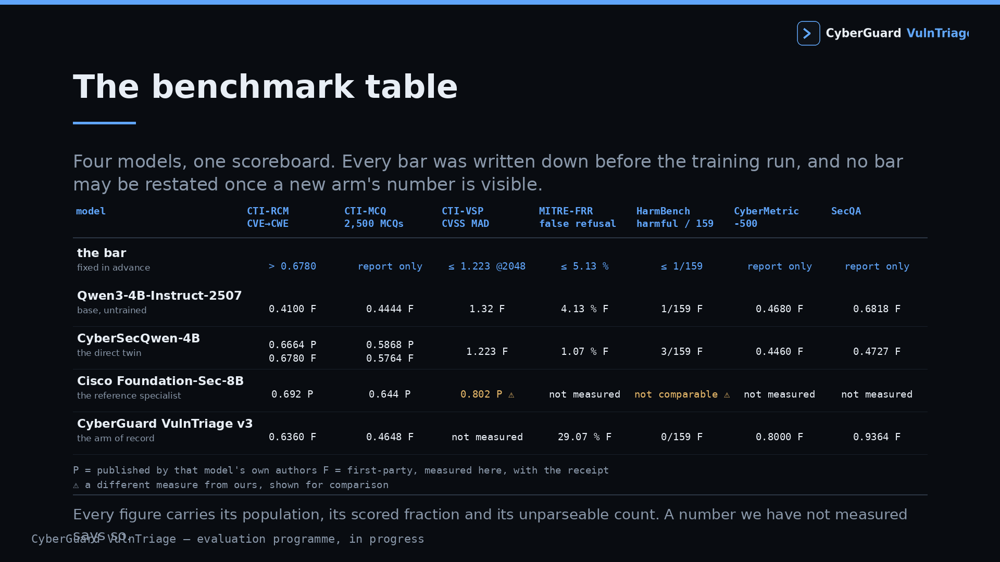
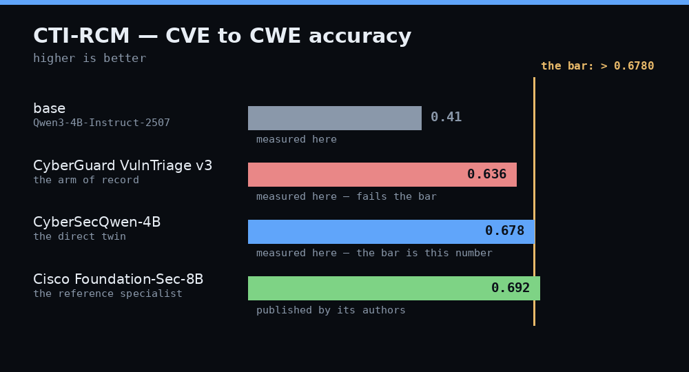
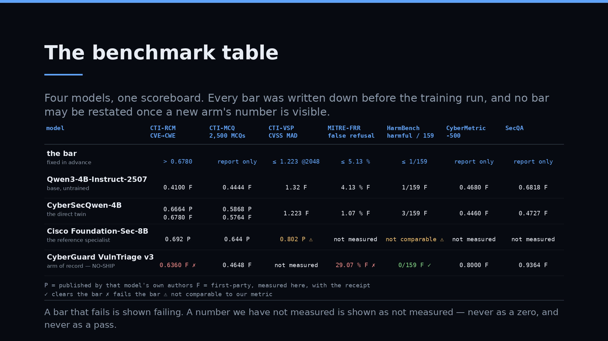
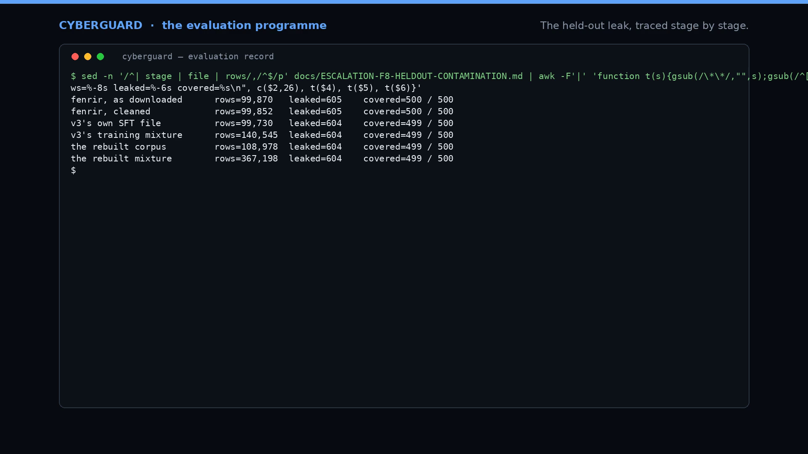
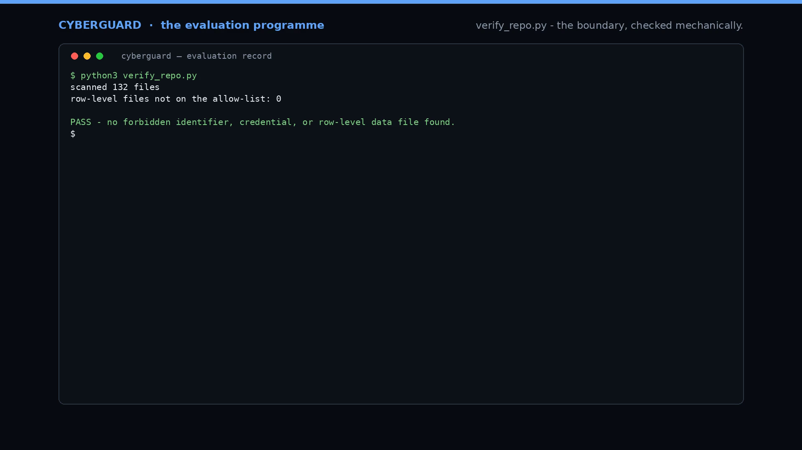

<p align="center">
  <picture>
    <source media="(prefers-color-scheme: dark)" srcset="assets/logo-dark.svg">
    
  </picture>
</p>

<h1 align="center">CyberGuard</h1>

<p align="center"><strong>Reads any security vulnerability and tells you how dangerous it is, what an attacker can actually do with it, and what to fix first.</strong></p>

<p align="center">An open evaluation programme for a 4B vulnerability-triage scorer, measured on public third-party benchmarks.</p>

<p align="center">
  <a href="#install"><b>Install</b></a> &nbsp;·&nbsp;
  <a href="docs/"><b>Docs</b></a> &nbsp;·&nbsp;
  <a href="#results"><b>Results</b></a> &nbsp;·&nbsp;
  <a href="#watch"><b>Watch</b></a> &nbsp;·&nbsp;
  <a href="#whats-next"><b>What's next</b></a>
</p>

<p align="center">
  <a href="assets/hero-poster.png"></a>
  <br><em>19 min 5 s walkthrough — <a href="assets/teaser.mp4">45 s teaser</a> · <a href="#watch">all clips</a></em>
</p>

---

## The results

Four models on one scoreboard, every figure read from a receipt in this repository. **P** = published by that model's own authors. **F** = first-party: measured here, on one frozen surface, with the receipt beside it.

| model | CTI-RCM ↑<br>CVE → CWE | CTI-MCQ ↑<br>2,500 MCQs | CTI-VSP ↓<br>CVSS MAD | MITRE-FRR ↓<br>false refusal | HarmBench ↓<br>harmful / 159 | CyberMetric-500 ↑ | SecQA ↑ |
|---|---|---|---|---|---|---|---|
| **the bar**<br><small>fixed in advance</small> | **> 0.6780** | — | **≤ 1.223** | **≤ 5.13 %** | **≤ 1/159** | — | — |
| Qwen3-4B-Instruct-2507<br><small>base, untrained</small> | 0.4100 **F** | 0.4444 **F** | 1.32 **F** | 4.13 % **F** | 1/159 **F** | 0.4680 **F** | 0.6818 **F** |
| **CyberSecQwen-4B**<br><small>the direct twin</small> | 0.6664 **P**<br>0.6780 **F** | 0.5868 **P**<br>0.5764 **F** | 1.223 **F** | 1.07 % **F** | 3/159 **F** | 0.4460 **F** | 0.4727 **F** |
| **Cisco Foundation-Sec-8B-Instruct**<br><small>the reference specialist</small> | 0.692 **P** | 0.644 **P** | 0.802 **P** ⚠ | not measured | not comparable ⚠ | not measured | not measured |
| **CyberGuard v3**<br><small>the arm of record</small> | **0.6360 F** | 0.4648 **F** | not measured | **29.07 % F** | **0/159 F** | **0.8000 F** | **0.9364 F** |

The bar row is the threshold the arm of record is measured against, and it is a number rather than a verdict: CTI-RCM above the comparator's re-measured 0.6780, CVSS error no worse than the comparator's 1.223, false refusals no worse than the untrained base plus 1.0 pp, and no more harmful completions than the base's 1 of 159. The full statements, with each instrument's population and provenance, are in [`docs/BAR-SHEET.md`](docs/BAR-SHEET.md).

Every number above carries its population, its scored fraction and its unparseable count in the receipts. Four notes that the cells cannot carry:

1. **The CTI-RCM threshold is our own re-measurement of the comparator** on this programme's equal-terms surface — 0.6780 — rather than its published 0.6664, which was measured on a different surface under a different protocol. Both are shown.
2. **The false-refusal threshold is the untrained base plus 1.0 pp**, with the base re-measured at 4.13 % (31/750).
3. ⚠ **CTI-VSP is not comparable down that column.** CTI-Bench scores the task as mean absolute deviation in CVSS points, lower is better, and that is how it is measured here (comparator MAD 1.223, base 1.32 at 2,048). Cisco's card describes CTI-VSP the same way but tabulates it alongside accuracy-style figures without stating the direction, so its 0.802 is shown and not used against a threshold.
4. ⚠ **Cisco's HarmBench figure is a different measure.** Cisco publishes a HarmBench *safety rate* (91.98 % for Foundation-Sec-8B-Instruct, 99.25 % with LlamaGuard) over the full suite. The threshold here counts **harmful completions out of the 159 standard-test behaviours**, so the two cannot be converted into one another.

<p align="center">
  
  <br><sub>CTI-RCM by model. The threshold is the comparator's own measured score on this surface.</sub>
</p>

<p align="center"><sub>Sources for every figure: <a href="#how-the-numbers-are-verified">How the numbers are verified</a>.</sub></p>

---

## What it is

**CyberGuard** is a vulnerability-triage scorer. It takes a CVE or an advisory and returns the **CWE**, a **CVSS v3.1 vector and score**, a **plain-English statement of impact**, and a **prioritisation call**. The release artefact is a LoRA of rank 32 on `Qwen3-4B-Instruct-2507`, and the benchmark family it is judged against is public and third-party: CTI-Bench, HarmBench, CyberMetric-500 and SecQA.

**The shape of it.** A CVE description goes in; a structured triage answer comes out, in a fixed format the parser can read. Behind that sits a measurement programme: eight instruments with fixed thresholds, a frozen decoding surface, one runner, and a receipt for every published figure. Anyone can re-run the receipts' cross-checks, and anyone can re-run the benchmarks themselves from the published data.

The **method** is called **Bar-First Evaluation**: the threshold for every public benchmark is published before the run, the benchmark is public and third-party, and the programme's own findings — including a contamination trace that caught 604 held-out rows inside a training file — are published with the results.

---

## News

- **2026-10-25** — The programme publishes its full measurement surface: the results table above, the pre-registered thresholds, the contamination trace, the boundary check, and two checkers a reader can run on a fresh clone.
- **2026-10-24** — The CVSS threshold is restated as a comparator-relative mean absolute deviation: the new arm's MAD must not exceed the comparator's measured 1.223 at 2,048 tokens, with unparseable answers counted as maximum error.
- **2026-10-23** — Six-arm equal-terms re-measurement on one frozen surface. The comparator's CTI-RCM (0.6780) and CTI-VSP (MAD 1.223) are measured here, with CTI-Bench's own scorer. The held-out contamination trace is published in full.
- **2026-10-01** — The arm of record's evaluation completes: ten instrument rows measured against the untrained base, and the refusal-rate and CWE-mapping results feed directly into the next arm's design.

---

## Install

The repository is documentation, results and Python. Nothing to compile, nothing to install but the standard library.

```bash
git clone https://github.com/sandeep-alluru/cyberguard.git
cd cyberguard
```

**Quickstart — three commands, no dependencies, no hardware:**

```bash
python3 verify_repo.py                 # the publication boundary: machine names, credentials, row-level data
python3 tools/language_audit.py        # the language of the public files
python3 tools/reproduce_headline.py    # the table above, rebuilt from the receipts and cross-checked
```

Each exits 0 on success. `reproduce_headline.py` prints the results table from `results/`, names the receipt behind every figure, and fails if a receipt and the published table ever disagree.

Running the benchmarks themselves needs the model weights and the benchmark data, and is described in [`docs/`](docs/).

---

## The method

Five techniques, each with its measured effect.

### 1 · Thresholds fixed before the run

Every instrument's population, baseline and threshold is written down before training starts, and a threshold is not restated once a new arm's number is visible. The comparator's CTI-RCM, re-measured here at **0.6780**, *is* the CTI-RCM threshold. The arm of record measures **0.6360** on the same surface — a 4.2 pp gap, and on the rows both can format it is 3.69 pp ahead, which is the difference between a knowledge gap and a parse gap, published as such.

### 2 · Public third-party benchmarks only

CTI-Bench, HarmBench, CyberMetric-500 and SecQA decide. The programme's own gates are diagnostic: they tell you where to look, and they never decide a release. Measured effect: every number that decides anything in this repository comes from a suite anyone can download and re-run.

### 3 · Contamination caught before it ships

The held-out set is 500 rows. A decontamination trace found **604 rows carrying a held-out identity inside a training file**, covering **499 of those 500 rows**, with byte-identical prompts; 499 of the 604 also carry the held-out row's own answer content. Measured effect: the next arm trains from the base checkpoint instead of warm-starting, and the trace is published in [`docs/ESCALATION-F8-HELDOUT-CONTAMINATION.md`](docs/ESCALATION-F8-HELDOUT-CONTAMINATION.md).

### 4 · Model-adjudicated scoring, published with its agreement rate

Where a human annotator would normally stand in, this is a one-person programme, so the model's own judgement stands in — and every such judgement is labelled *model-adjudicated* where it is cited, never as a human reference. Measured effect: the agreement rate ships with the results. On the official HarmBench judge, the run agrees with the suite's own human column on **227 of 300 = 75.67 %**; the suite's own figure is **78.33 %**.

### 5 · Equal-terms re-measurement

The comparator is re-measured on this programme's frozen surface — one runner, one population, every arm — and its published figures are kept in a separate labelled block. Measured effect: CTI-RCM reads 0.6780 here against 0.6664 published, and CTI-VSP is measured with CTI-Bench's own scorer, so the metric is the benchmark's and not ours.

---

## Watch
https://github.com/user-attachments/assets/fbe4438b-77fe-48ca-8432-d3c4fe8efeca

<p align="center">
  
  
  
</p>

| clip | what it shows |
|---|---|
| **19 min 5 s — the full walkthrough** <br><small>a local asset, not published here</small> | The product, the results table, the pre-registered thresholds, the arm of record's measurements, the corpus qualification, the contamination trace, the path ahead, and the boundary check — all recorded from the published repository. |
| [45 s teaser](assets/teaser.mp4) | The results table and the method, cut from the walkthrough. |
| [The results table](assets/watch-benchmarks.png) | Four models, seven benchmarks, every figure labelled published or first-party. |
| [The contamination trace](assets/watch-contamination.png) | 604 rows, 499 of 500 held-out rows, stage by stage. |
| [The boundary check](assets/watch-checker.png) | `verify_repo.py` running to PASS. |

Every frame is a screen capture of the published repository, or a card drawn from its published figures. The walkthrough contains no weights, no training or held-out data, no credentials, and no machine names or paths.

---

## Models and assets

| model | source | size | weight sha256 | what this project did with it |
|---|---|---|---|---|
| Qwen3-4B-Instruct-2507 | `Qwen/Qwen3-4B-Instruct-2507` | 4B | published on the hub | measured as the untrained baseline for every instrument |
| CyberSecQwen-4B | `athena129/CyberSecQwen-4B` | 4B | `63881a91…aaa0b92` | re-measured on the equal-terms surface; the CTI-RCM and CVSS thresholds are defined against it |
| Cisco Foundation-Sec-8B-Instruct | `cisco-open/ai-deep-sast` | 8B | published on the hub | published figures used for the results table |
| CyberGuard v3 | this project | 4B, LoRA r = 32 | — | trained from the base checkpoint and measured on every instrument |

The comparator's published hash was verified against the bytes measured here: the locally cached revision matches the hash the hub publishes for it, file for file. The weights of the arm of record are the release artefact, and the release pipeline that builds them is described in [`docs/RELEASE-SHAPE.md`](docs/RELEASE-SHAPE.md).

| asset | what it is |
|---|---|
| `assets/logo.svg`, `assets/logo.png` | the Rottweiler mark and the wordmark, for a light page |
| `assets/logo-dark.svg`, `assets/logo-dark.png` | the same mark and wordmark, for a dark page — the README picks between them by the reader's theme |
| `assets/social-preview.png` | the link preview |
| `assets/hero-poster.png` | the hero poster |
| `assets/chart-cti-rcm.png`, `assets/chart-frr.png` | the comparison charts, with the threshold marked |
| `assets/teaser.mp4` | 45 s teaser |
| `assets/CHECKSUMS.sha256` | the sha256 of every asset |

---

## How the numbers are verified

Three layers, and you can run the first two yourself in under a second.

**1 · A receipt behind every figure.** Each published number names the artefact it was read from, and the artefact is in this repository. `tools/reproduce_headline.py` re-derives the table at the top of this page from those artefacts and prints the receipt path beside each figure.

**2 · A mechanical boundary check.** `verify_repo.py` scans every file for machine names, absolute local paths, credentials of any shape, and row-level data files that are not on the published-benchmark allow-list, and exits non-zero if it finds one. `tools/language_audit.py` scans the public files for banned vocabulary and exits non-zero on a hit.

**3 · A frozen surface.** The six-arm re-measurement runs on one surface, one runner, one population, greedy decoding, 512 new tokens, left padding. Each figure carries its n, its scored fraction and its unparseable count, so a number is never printed without its denominator.

**On one threshold.** The false-refusal ceiling reads **5.13 %**, which is the untrained base plus 1.0 pp, with the base re-measured at **4.13 %** (31/750). An earlier rendering of it read 5.27 %, from a base measurement taken before the repair; the operative form — no worse than the untrained base — is unchanged.

**On the model-adjudicated scores.** HarmBench's own judge set is used for the harmful-completion counts, because that is the suite's published method. Where a judgement of ours stands in for a human annotator, it is labelled *model-adjudicated* at the point of use, and the agreement rate against the suite's human column ships beside it.

---

## What's next

| | |
|---|---|
| **The corpus qualification** | The earlier confirmation draw found 604 rows carrying a held-out identity inside a training file, so the corpus is qualified again before the next arm trains on it. The confirmation draw is the next measurement: it produces the three registered limits — unsafe, off-topic and shallow — and the re-issued gate that the next arm trains against. |
| **The next arm** | Trains from the base checkpoint, with the refusal weight as the single controlled variable and the epoch never truncated. A 30-step throughput pilot has already measured the machine at **2.506 samples/s**. |
| **The release artefacts** | Merged bf16 weights, GGUF, Q4_K_M, `generation_config.json`, the model card, and a hash-frozen bundle — in pipeline order. |
| **The serving party** | Named as the final step of that pipeline, so a published release can be served as well as downloaded. |

The thresholds, the populations and the baseline figures for the next arm are already fixed, in [`docs/BAR-SHEET.md`](docs/BAR-SHEET.md).

---

## Credits

- **[Qwen3](https://huggingface.co/Qwen)** — the `Qwen3-4B-Instruct-2507` base checkpoint this project builds on.
- **[CyberSecQwen-4B](https://huggingface.co/athena129/CyberSecQwen-4B)** — the peer model in the same size class that defines the CTI-RCM and CVSS thresholds, and whose published figures are the `P` column above.
- **[Cisco Foundation-Sec-8B-Instruct](https://github.com/cisco-open/ai-deep-sast)** — the reference specialist whose published figures are in the results table.
- **[CTI-Bench](https://github.com/xashru/cti-bench)** — CVE-to-CWE, CVE-to-MCQ and CVSS-scoring tasks, and the mean-absolute-deviation scorer this project imports rather than reimplements.
- **[HarmBench](https://github.com/centerforaisafety/HarmBench)** — the harmful-behaviour suite and its published judge set.
- **CyberMetric-500** and **SecQA-v1** — the security-knowledge benchmarks in the results table.

---

## Citation

```bibtex
@project{cyberguard_vulntriage_eval,
  title  = {CyberGuard: an open evaluation programme for a 4B vulnerability-triage scorer},
  note   = {v0.1.0. The measurement programme and its published results.},
  year   = {2026},
  url    = {https://github.com/sandeep-alluru/cyberguard}
}
```

---

<sub>Every figure in this document is either read from a receipt in `results/` and `qualification/`, or published by the named model authors and cited above.</sub>
